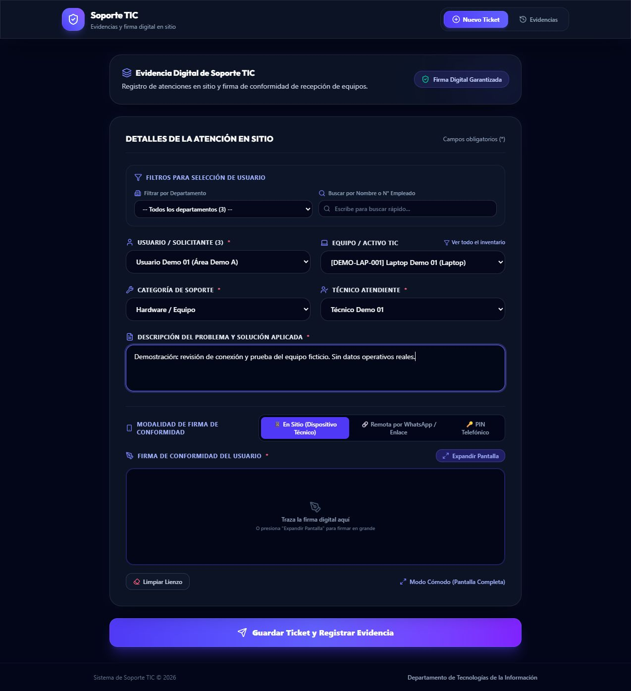
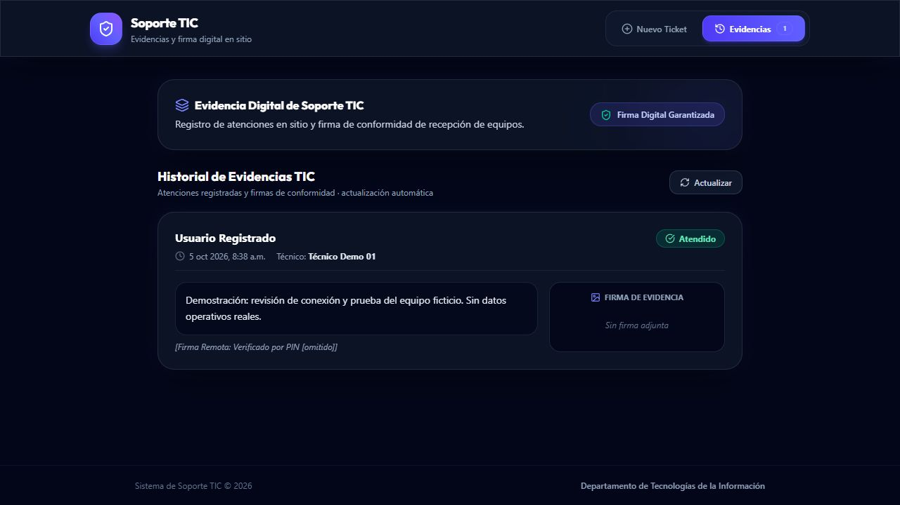

# Registros TIC

Demostración saneada de aplicación web para el registro, trazabilidad de soporte técnico y consulta de evidencias.

> [!NOTE]
> **Demostración local saneada.** El código de frontend y el esquema de base de datos se proporcionan con datos sintéticos y persistencia local para evaluación técnica. El entorno productivo y las credenciales operativas no forman parte de este repositorio.

[Ejecutar la demostración](#ejecutar-una-demostración-local) · [Caso de estudio](docs/case-study.md) · [Arquitectura](docs/architecture.md) · [Estado del proyecto](docs/project-status.md) · [Revisión de privacidad](docs/privacy-review.md)

## Problema

El seguimiento de atenciones de soporte técnico requiere reunir en un único punto la descripción de la incidencia, el equipo o activo involucrado, la persona solicitante, el técnico responsable y la conformidad final del servicio. Cuando la información se fragmenta en mensajes y notas informales, se pierde la trazabilidad operativa y se dificulta la generación de reportes periódicos de soporte.

## Solución

Una aplicación web diseñada para dispositivos móviles y escritorio que centraliza el flujo de atención:
- Selección ágil mediante catálogos relacionados de solicitantes, departamentos y activos.
- Modalidades de registro de atención y captura de conformidad (firma presencial en pantalla o PIN de verificación local).
- Consulta histórica de evidencias y tickets registrados, persistidos en el almacenamiento local del navegador (`localStorage`) o en PostgreSQL a través de Supabase en entornos configurados.

## Capturas de la demostración

Formulario de registro con catálogos sintéticos:



Historial de ticket registrado con PIN visualmente protegido:



*Las etiquetas de la interfaz «Firma Digital Garantizada» y «Verificado por PIN» describen el texto del prototipo; no acreditan validez jurídica ni controles criptográficos de producción.*

## Aportación personal

Relevé las necesidades operativas del equipo de soporte para diseñar la interfaz móvil responsiva en React/TypeScript y modelar el esquema relacional de datos (usuarios, activos y categorías). Implementé la persistencia local en el navegador para el modo demo y la integración con el SDK de Supabase/PostgreSQL para la trazabilidad y consulta de atenciones.

## Ejecutar una demostración local

Requisitos: Node.js 22.12 o posterior (compatible con Vite 8) y npm.

```sh
git clone https://github.com/Hmhn2525/registros-tic.git
cd registros-tic
npm ci
npm run dev -- --host 127.0.0.1
```

Para este recorrido demostrativo:
1. No cree archivo `.env` ni configure variables reales de conexión.
2. Abra la dirección local indicada por Vite en una ventana privada o perfil limpio del navegador.
3. Seleccione un usuario y un activo de demostración, capture una descripción ficticia y guarde el ticket.
4. Vaya a la sección **Evidencias** y recargue la página: observará que el registro ficticio persiste localmente.

Para validar calidad y compilación del código:

```sh
npm run lint
npm run build
npm run preview -- --host 127.0.0.1
```

*Nota: `vite dev` y `vite preview` sirven el frontend; no ejecutan la función de servidor `api/remote-signature.ts`.*

### Base de datos de demostración opcional

Para evaluar la integración con PostgreSQL, aplique `supabase_schema.sql` y posteriormente `supabase/seed.sql` en un proyecto Supabase aislado. La semilla contiene únicamente tres usuarios, tres activos y tres tickets ficticios sin información confidencial.

## Resultados comprobados

- **Trazabilidad y persistencia de soporte:** guardado local verificado con persistencia tras recarga del navegador en pruebas del 5 de octubre de 2026.
- **Protección visual de credenciales:** el PIN de confirmación se enmascara visualmente en el historial.
- **Calidad de código verificada:** comandos `npm run lint` y `npm run build` ejecutados exitosamente sin errores de compilación TypeScript.

No se publican métricas cuantitativas no medidas de reducción de tiempos o adopción.

## Tecnologías verificadas

| Capa | Tecnologías |
|---|---|
| Frontend | React, TypeScript, Vite, Tailwind CSS, Workbox, PWA |
| Persistencia y datos | `localStorage` (modo demo), SDK de Supabase, PostgreSQL |
| Complementarias | `react-signature-canvas`, Looker Studio (diseño de reporting documentado) |

## Límites y pendientes

- Se detectaron dos advertencias de vulnerabilidad alta en dependencias transitivas (`brace-expansion`, `fast-uri`) pendientes de actualizar en una fase técnica propia.
- El modo demo utiliza almacenamiento en navegador; la sincronización offline bidireccional y la validación estricta de tokens en servidor permanecen pendientes.
- La integración con Looker Studio está documentada en `docs/reporting.md`, sin un tablero productivo activo verificado.

Detalle técnico completo: [estado del proyecto](docs/project-status.md) y [revisión de privacidad](docs/privacy-review.md).

## Licencia

Pendiente de decisión expresa. No se incluye archivo `LICENSE` ni se autoriza distribución comercial no acordada.
