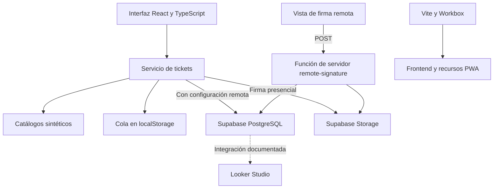

# Arquitectura de Registros TIC

Descripción del código revisado el 5 de octubre de 2026. La integración remota se describe por inspección; el recorrido ejecutado utilizó el modo demo local.

## Interfaz y datos

`src/App.tsx` alterna formulario e historial; con `firmar_token` en la URL muestra la vista de firma remota. El formulario selecciona usuario, activo, categoría y técnico, y construye el registro. El lienzo usa `getCanvas()` y conserva `touch-action: none` para el trazo táctil.

`src/services/ticketService.ts` ofrece catálogos sintéticos cuando Supabase no está configurado. En ese modo guarda tickets en `tic_tickets_offline_queue` y los devuelve al historial. Los registros locales no se enriquecen con todas las relaciones de catálogos: el historial puede mostrar «Usuario Registrado» en lugar del nombre demo.

Con configuración remota, el servicio consulta catálogos, sube la firma a Storage e inserta el ticket. Si la inserción falla conserva una copia local; si falla la subida previa de firma devuelve un error y el ticket no se guarda. No existe un motor que envíe la cola al recuperar conexión. El polling del historial consulta registros, sin vaciar ni sincronizar la cola.

## Persistencia e integración

PostgreSQL relaciona `usuarios`, `activos_tic`, `categorias_soporte` y `tickets`. El esquema inicial y las migraciones definen la estructura; `supabase/seed.sql` aporta ejemplos sintéticos para una base aislada. No hay cambios de esquema en esta etapa documental.

Las imágenes de firma usan el bucket `firmas` y URLs públicas en la implementación actual. La clave pública de Supabase no sustituye a la autorización: las políticas anónimas actuales requieren endurecimiento antes de usar información real.

## Firma remota

El frontend genera un UUID, calcula su hash SHA-256 y construye un enlace. `api/remote-signature.ts` acepta solicitudes POST con `signatureToken` y `signatureDataUrl`, valida formato y tamaño, consulta por hash y procesa la imagen mediante una credencial exclusiva del servidor. Este documento conserva el contrato existente; no modifica la API.

Vite no ejecuta esta función. Su despliegue completo, permisos y concurrencia no se probaron en esta etapa. Siguen pendientes vencimiento del token, límites de intentos, validación del contenido de imagen y pruebas concurrentes. El PIN se guarda en notas y su ocultamiento en pantalla no representa validación independiente.

## PWA y reporting

Vite genera el frontend; Workbox genera service worker y precache. Los iconos declarados en la configuración siguen incompletos. Compilar no acredita instalación ni operación offline completa en dispositivos móviles.

Looker Studio es una integración documentada y pendiente de validación. La guía actual recomienda reportes sin firmas personales y acceso restringido de solo lectura. No se afirma que exista un tablero conectado.
